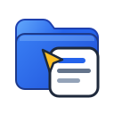

<div align="center">
  
  <h1>FileView Explorer (<code>agy-fileview</code>)</h1>
  <p><strong>Enhanced side-panel file explorer MCP App plugin for Google Antigravity with full right-click file operations.</strong></p>
  <p><a href="README.zh-CN.md">简体中文</a> · English</p>
</div>

---

## Why `agy-fileview`?

In the Antigravity desktop App, the built-in Files panel only offers a basic copy action on right-click. Because Antigravity's official plugin API does not allow patching built-in panel context menus directly, **FileView** uses Antigravity's official **MCP Apps** (`aux_pane` + `global`) surface to provide a full-featured, native-themed file manager right inside your side panel (which you can pin as a permanent tab).

## Features

- **Right-Click Context Menu for Files, Folders & Empty Space**:
  - **Reveal in File Explorer / Finder** (`explorer.exe /select` on Windows, `open -R` on macOS, `FileManager1` / `xdg-open` on Linux)
  - **Open with Default App**
  - **Open in Antigravity Side Pane** (`toggle-aux-pane`, with automatic quick text preview fallback in full-page view)
  - **Open Terminal Here** (Windows Terminal `wt.exe` with PowerShell fallback, macOS Terminal, Linux terminal emulators)
  - **Copy Full Path / Relative Path / File or Folder Name** (3-tier clipboard copy including host OS fallback)
  - **Attach to Chat Context** (`updateModelContext`, when opened in a conversation side panel)
  - **Standard File Operations**: New File, New Folder, Rename (`F2`), Copy (`Ctrl+C`), Cut (`Ctrl+X`), Paste (`Ctrl+V`), Duplicate, Move to Recycle Bin / Trash (`Delete`, with optional permanent delete), and **Properties** (`Alt+Enter`, including folder counts & on-demand SHA-256 checksum)
- **Workspace & Location Switcher**: Auto-discovers Antigravity projects, pinned folders, OS shortcuts (Home, Desktop, Documents, Downloads), drives, and jump-to-path navigation.
- **Fast Filter & Recursive Search**: Instant filter over the expanded tree plus recursive deep filename search.
- **Native Antigravity Theming & Bilingual UI**: Automatically syncs Light/Dark theme and host CSS variables, with one-click Chinese/English toggle (`中` / `EN`).
- **Zero Runtime Dependencies**: Pre-bundled `dist/server.mjs` and `dist/app.html` run directly with Node.js—no `npm install` needed to use the plugin.

## Installation (Zero-Dependency)

Clone directly into your Antigravity global plugins directory:

```bash
git clone https://github.com/LiangYu-ac/agy-fileview.git ~/.gemini/config/plugins/agy-fileview
```

On Windows PowerShell:

```powershell
git clone https://github.com/LiangYu-ac/agy-fileview.git "$env:USERPROFILE\.gemini\config\plugins\agy-fileview"
```

Antigravity automatically discovers plugins in `~/.gemini/config/plugins/` without requiring a restart.

## How to Use

1. Open **FileView** in the side panel via any of these entrypoints:
   - **Overview** panel → **Plugins** → **FileView**
   - Side panel **`+`** (New Tab) → **Plugins** → **FileView**
   - Left sidebar → **Plugins** → **FileView** (full-page view)
   - Or invoke `/fileview` in chat
2. **Tip**: Right-click the **FileView** tab in the side panel and select **Pin Tab** to keep it pinned beside your conversations.
3. Right-click any file, folder, or blank area inside FileView to reveal its location or run file actions.

## Keyboard Shortcuts

| Shortcut | Action |
| --- | --- |
| `ArrowUp` / `ArrowDown` | Move selection |
| `ArrowRight` / `ArrowLeft` | Expand / collapse folder |
| `Enter` | Open folder as root, or open file in Antigravity |
| `F2` | Rename |
| `Ctrl+C` / `Ctrl+X` / `Ctrl+V` | Copy / Cut / Paste |
| `Delete` | Move to Recycle Bin |
| `Alt+Enter` | View Properties |
| `Escape` | Close context menu or dialog |

## Development & Building

```bash
npm install
npm run build
npm test
```

`npm run build` bundles `src/server.mjs` → `dist/server.mjs` and `src/ui/` → `dist/app.html` using `esbuild`.

## License

[MIT](LICENSE)
