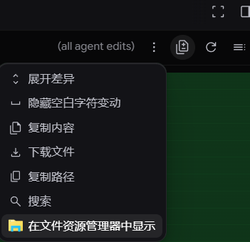

<div align="center">
  
  <h1>FileView Explorer (<code>agy-fileview</code>)</h1>
  <p><strong>Google Antigravity 增强版侧边栏文件管理器插件，支持右键查看文件位置与全套常规文件操作。</strong></p>
  <p>简体中文 · <a href="README.md">English</a></p>
</div>

<div align="center">
  
</div>

---

## 让 AI 一键安装（复制以下提示词发送给反重力）

直接复制下面这段话发给 **Antigravity（反重力）** 或任意 AI 编程助手，即可自动完成下载、安装与激活：

```text
请帮我下载并安装（或更新）反重力文件管理插件 agy-fileview（仓库地址：https://github.com/LiangYu-ac/agy-fileview.git）：
1. 根据当前系统定位 Antigravity 全局插件目录：Windows 为 "$env:USERPROFILE\.gemini\config\plugins\agy-fileview"，macOS / Linux 为 "$HOME/.gemini/config/plugins/agy-fileview"。
2. 若该目录已存在 git 仓库则执行 `git pull` 更新，否则执行 `git clone https://github.com/LiangYu-ac/agy-fileview.git <目标目录>`。（仓库已包含打包产物 dist/server.mjs 与 dist/app.html，无需运行 npm install。）
3. 检查插件是否已被 Antigravity 发现并处于启用状态，必要时刷新连接 `agy-fileview_explorer` MCP 服务，并告诉我如何打开 FileView 面板。
```

---

## 插件在哪里打开与使用？

由于 Antigravity 官方插件 API 暂不支持直接修改原生内置面板的右键菜单，**FileView** 通过官方 **MCP Apps**（`aux_pane` 侧边栏 + `global` 全屏视图）提供了一个独立的增强版文件管理器面板。你可以通过以下 **4 个入口** 随时打开 **FileView**：

1. **概览面板（Overview）**：点击对话右上角 **Overview（概览）** → **Plugins** → **FileView**
2. **侧边栏标签栏 `+`**：点击侧边栏顶部的 **`+`（新建标签页）**，或点击对话右上角 **`⋯`（更多操作）** → **Plugins** → **FileView**
3. **左侧导航栏（全屏视图）**：点击 Antigravity 左侧边栏 **Plugins** → **FileView**
4. **对话命令 / 自然语言**：在聊天框输入 `/fileview`，或直接让 AI 打开 FileView / 在资源管理器中定位某个文件

> **推荐固定用法**：在侧边栏打开 **FileView** 后，右击该标签页选择 **Pin Tab（固定标签页）**，即可常驻侧边栏替代原生文件树。在 **FileView** 内右击任意文件、文件夹或空白处，即可弹出完整操作菜单（在文件资源管理器中显示、默认程序打开、打开终端、复制路径、重命名、复制/剪切/粘贴、移至回收站、属性等）。

---

## 为什么做这个插件？

Antigravity 桌面端自带的“文件（Files）”面板右键菜单目前只有基础复制功能。**FileView** 提供了一套原生深浅主题自适应、中英双语切换、支持完整右键管理的文件浏览器面板。

## 核心功能

- **文件 / 文件夹 / 空白处完整右键菜单**：
  - **在资源管理器中显示**：Windows 调用 `explorer.exe /select` 精准高亮选中文件（兼容 macOS `open -R` / Linux 文件管理器）
  - **用系统默认程序打开**
  - **在 Antigravity 侧边栏打开**：调用宿主文件视图打开文件（全屏模式下自动降级为内置文本预览弹窗）
  - **在此处打开终端**：优先使用 Windows Terminal（`wt.exe`），自动回退到 PowerShell
  - **路径与名称复制**：复制完整路径、复制相对路径、复制文件/文件夹名（自带三层剪贴板回退，确保沙盒 iframe 下也能稳定写入系统剪贴板）
  - **附加到对话上下文**：一键将选中文件路径附加到当前对话（侧边栏模式可用）
  - **常规文件管理**：新建文件、新建文件夹、重命名（`F2`）、复制（`Ctrl+C`）、剪切（`Ctrl+X`）、粘贴（`Ctrl+V`）、创建副本、移至回收站（`Delete`，可选彻底删除）、属性查看（`Alt+Enter`，支持文件夹统计与按需计算 SHA-256）
- **项目与目录快速切换**：自动发现 Antigravity 项目列表，支持收藏固定文件夹、常用目录（桌面/文档/下载/主目录）、盘符切换及路径直达。
- **双模式搜索**：支持对当前展开树进行实时过滤，以及一键切换为递归深度搜索文件名。
- **原生主题与中英双语**：自动跟随 Antigravity 深色/浅色主题与字体变量，右上角支持 `中 / EN` 一键切换。
- **开箱即用（零运行时依赖）**：已将服务端与前端完整打包至 `dist/server.mjs` 和 `dist/app.html`，克隆后无需执行 `npm install` 即可直接使用。

## 手动命令安装

直接克隆到 Antigravity 全局插件目录即可（无需安装依赖、无需重启）：

**Windows PowerShell：**

```powershell
git clone https://github.com/LiangYu-ac/agy-fileview.git "$env:USERPROFILE\.gemini\config\plugins\agy-fileview"
```

**macOS / Linux：**

```bash
git clone https://github.com/LiangYu-ac/agy-fileview.git ~/.gemini/config/plugins/agy-fileview
```

## 快捷键

| 快捷键 | 功能 |
| --- | --- |
| `↑` / `↓` | 上下移动选中项 |
| `→` / `←` | 展开 / 折叠文件夹 |
| `Enter` | 进入文件夹，或在 Antigravity 侧边栏打开文件 |
| `F2` | 重命名 |
| `Ctrl+C` / `Ctrl+X` / `Ctrl+V` | 复制 / 剪切 / 粘贴 |
| `Delete` | 移至系统回收站 |
| `Alt+Enter` | 查看文件/文件夹属性 |
| `Escape` | 关闭右键菜单或弹窗 |

## 本地开发与构建

```bash
npm install
npm run build
npm test
```

运行 `npm run build` 会使用 `esbuild` 将 `src/server.mjs` 打包为 `dist/server.mjs`，并将 `src/ui/` 打包内联为单文件 `dist/app.html`。

## 开源协议

[MIT](LICENSE)
